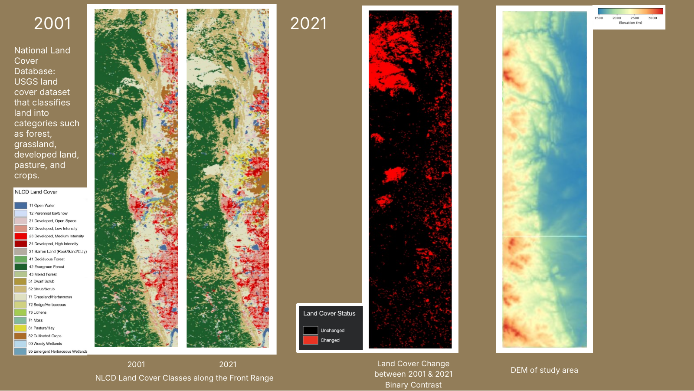
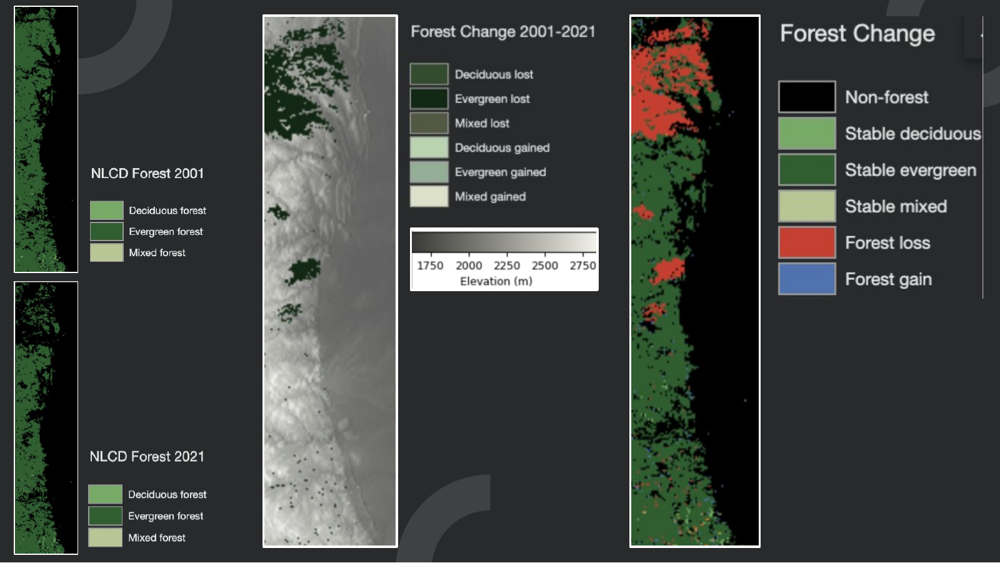
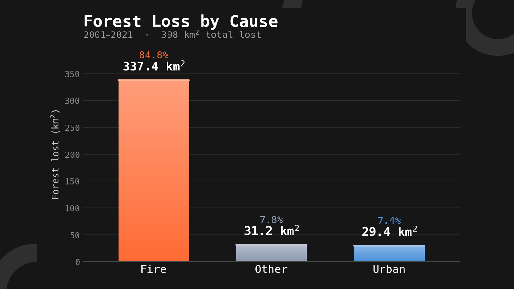
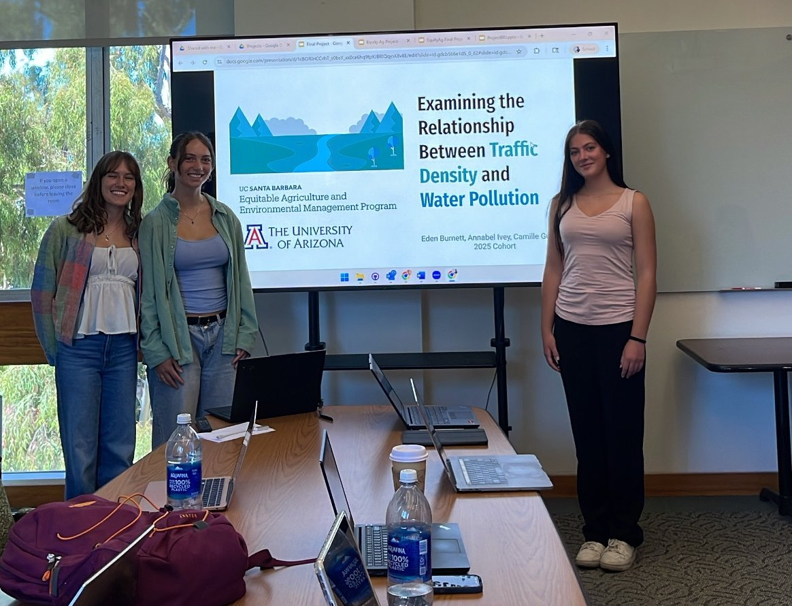
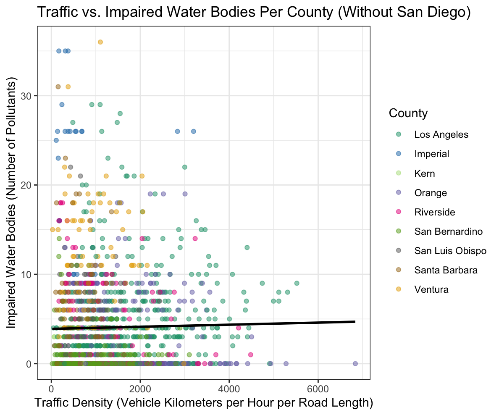
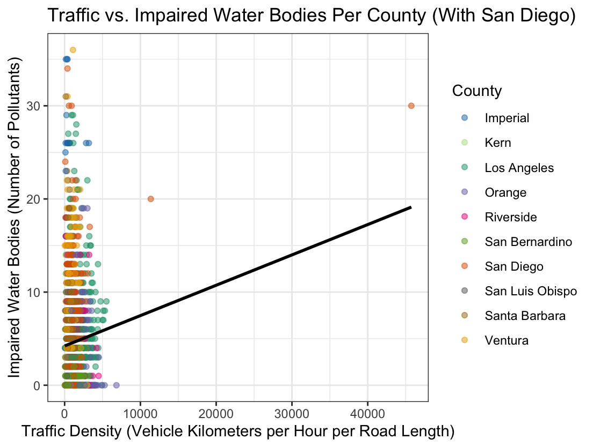

  
  <h1>Camille Guillen</h1>
  <h3>Agricultural Economics • GIS • Environmental Data Science</h3>
  
Student at Colorado State University

  

    
    
    
  

---

## About Me

I'm a Colorado State University student majoring in **Agricultural Economics** with a minor in **GIS for Natural Resources**. I use mapping, satellite imagery, and data analysis to understand agricultural and environmental systems and to support better decisions about land use and sustainability.

**Currently interested in:** GIS analysis • remote sensing • land cover change • sustainable agriculture

---

## Skills

| Area | Tools & Skills |
|---|---|
| **Programming** | Python, R |
| **GIS & Remote Sensing** | ArcGIS Pro, Landsat imagery, NLCD land cover data, Raster Analysis |
| **Data** | Excel, Data Visualization, Statistical Analysis |
| **Communication** | Research Writing, Scientific Presentations |

---

## Research & Projects

### 🌲 Forest Loss & Urban Growth Along Colorado's Front Range

**ESIIL Stars Internship • Environmental Data Science Innovation & Impact Lab (NSF-supported) • Summer 2026**

**Tools:** Python • GIS • Landsat • NLCD Land Cover • MODIS Burn Data

**Research question:** How has forest cover changed along the Front Range's elevation gradient over 20 years, and how much of that change is linked to urbanization?

Working with teammates Xinran Zhou and Malia Goldstien in the competitive ESIIL Stars Internship, I compared 2001 and 2021 NLCD land cover data with a digital elevation model, Landsat imagery, and MODIS burn data to see where forests, grasslands, farmland, and urban areas changed. We processed and analyzed the data in Python and GIS under the guidance of Dr. Sandra Durán and Dr. Mohammad Saif.

**What we found:**
- 🌲 Forest cover on the Front Range **declined about 19%** between 2001 and 2021, with most loss in evergreen forest.
- 🔥 About **85% of forest loss overlapped with wildfire burn areas**. Only about **7% was converted directly to urban land**.
- 🏘️ Grassland and urban cover expanded, and forest loss was slightly more common at lower elevations.

🎤 **This research will be presented at the AGU Fall Meeting in December 2026.**

📄 [Read our AGU abstract: *Two Decades of Forest Loss Across Colorado's Front Range: Patterns and Drivers Along an Elevational Gradient*](https://studio.m-anage.com/agu/agu26/meetingapp.cgi/Paper/2088802)

<table>
  <tr>
    <td></td>
    <td></td>
  </tr>
  <tr>
    <td align="center"><i>Where forest was lost and gained</i></td>
    <td align="center"><i>Forest loss by cause: fire, urban, other</i></td>
  </tr>
</table>

---

### 🥔 Colorado Potato Suitability Analysis

**Tools:** ArcGIS Pro • Raster Analysis • Weighted Overlay

Identified the most suitable land for potato production in Rio Grande County, Colorado, by combining elevation, slope, land cover, and distance to transportation into a suitability model.

<table>
  <tr>
    <td></td>
    <td></td>
  </tr>
  <tr>
    <td align="center"><i>Suitability map</i></td>
    <td align="center"><i>3D view</i></td>
  </tr>
</table>

📄 [Full Report](https://colostate-my.sharepoint.com/:w:/g/personal/c836883356_colostate_edu/IQC9MZNfwHaQQLv24uClU3D5AbAWyMh3OLqtMC0xq4g4aLM?e=hs7sjp) • 🗺️ [Map Layout (PDF)](https://github.com/user-attachments/files/27972272/Final.Analysis.Layout.pdf) • 🏔️ [3D Layout (PDF)](https://github.com/user-attachments/files/27972265/3D.Final.Analysis.Layout.pdf)

---

### 🚗 Traffic and Water Pollution in Southern California

**Applied Research • Equitable Agriculture and Environmental Management Program • Santa Barbara • July 2025**

**Tools:** R • ggplot2 • Regression & ANOVA • ArcGIS

In a two-week intensive program, my teammates Eden Burnett, Annabel Ivey, and I tested whether Southern California census tracts with more traffic also have more impaired water bodies, since tire wear sheds particles that can wash into streams and lakes. We used CalEnviroScreen 4.0 data for more than 1,600 census tracts.

*Presenting our final project at UC Santa Barbara, July 2025*

**What we found:**
- 🚦 Traffic had a statistically significant but very small effect on water pollution once we controlled for county.
- 🗺️ Differences between counties explained far more of the variation than traffic did.
- 📍 A single extreme tract in San Diego made the relationship look much stronger than it really is.

<table>
  <tr>
    <td></td>
    <td></td>
  </tr>
  <tr>
    <td align="center"><i>Without the San Diego outlier</i></td>
    <td align="center"><i>With the San Diego outlier</i></td>
  </tr>
</table>

---

### 🥕 Colorado Farmers Market Price Reports

**CSU Extension • CSU Food Systems • June 2026–Present**

**Tools:** R • Excel • Data Reporting

I manage weekly price data from farmers markets across Colorado, including Boulder, Fort Collins, Montrose, Palisade, and Pueblo, tracking prices for fruit, vegetables, meat, and eggs. Using R, I calculate the lowest, highest, and average price for each product and compile 5–10 reports each week that are published on the CSU Extension website.

**Why it matters:** Local farmers use these reports to compare prices across markets and set fair prices for their farm stands and CSA shares.

📄 [View the published price reports on the CSU Food Systems website](https://foodsystems.colostate.edu/market-prices-and-information/)

---

## Contact

📧 [camille.guillen@colostate.edu](mailto:camille.guillen@colostate.edu)
💼 [LinkedIn](https://www.linkedin.com/in/camille-guillen-274518359/)

Thanks for visiting!

